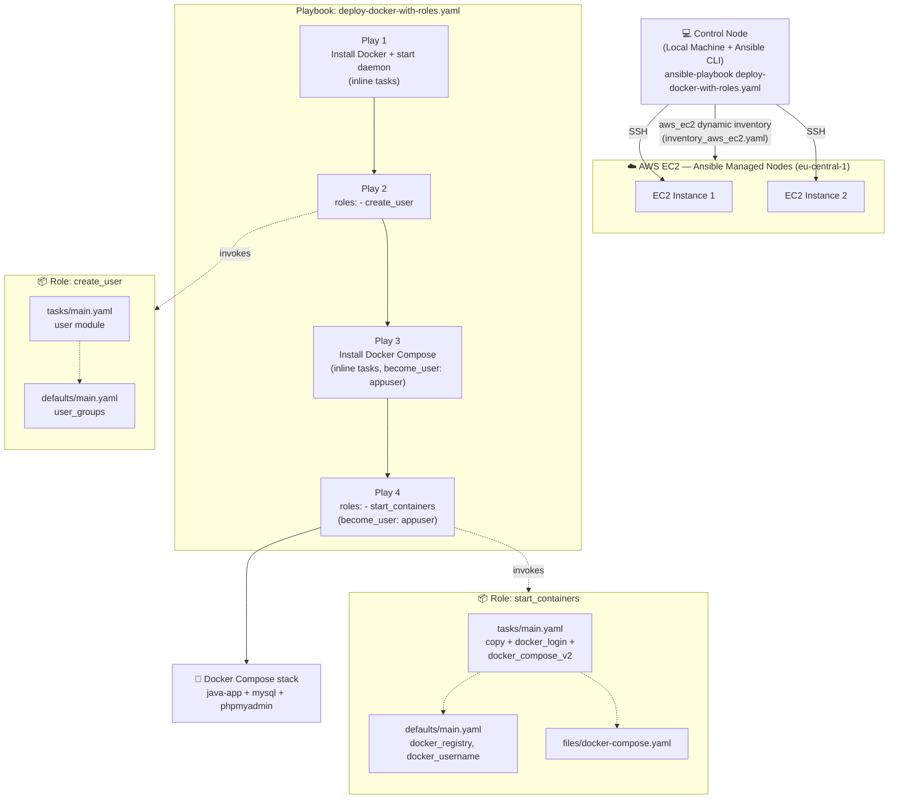
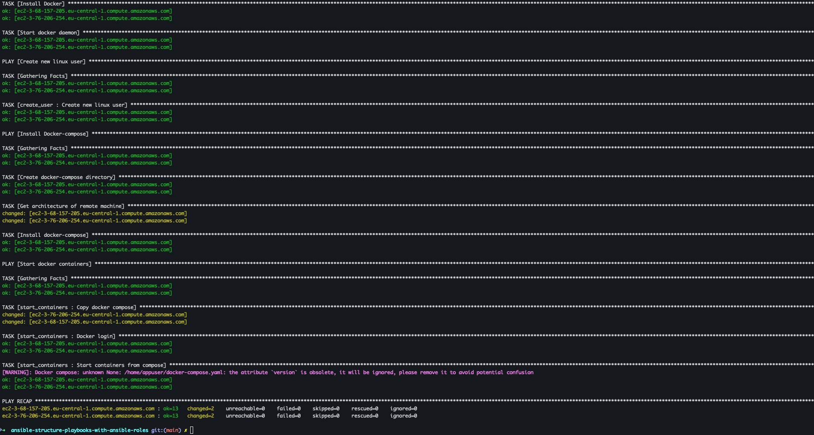

# 🚀 Ansible Structure Playbooks with Ansible Roles


**Ansible Automation** is an open-source, agentless IT automation engine that automates provisioning, configuration management, application deployment, and orchestration across large fleets of servers. It describes the *desired state* of a system using simple, human-readable YAML files called **playbooks**, and pushes those changes to managed nodes over standard **SSH** — without requiring any agent, daemon, or extra software installed on the target machines. Because every module is designed to be **idempotent**, running the same automation twice produces the same end state without unintended side effects, which makes Ansible a safe, repeatable and auditable way to manage infrastructure at scale.

## 📖 Overview

As an Ansible playbook grows, cramming every task into a single flat YAML file quickly becomes hard to read, hard to test, and impossible to reuse across projects. This project demonstrates how to refactor exactly that kind of large, monolithic playbook into **Ansible Roles** — Ansible's standard mechanism for breaking automation into small, self-contained, reusable units of work.

Two previously inline sets of tasks — creating a dedicated Linux user and starting a multi-container Docker application — are extracted out of the main playbook and into their own `create_user` and `start_containers` roles, each with its own `tasks/`, `defaults/`, `vars/` and `files/` directories. The main playbook, [deploy-docker-with-roles.yaml](deploy-docker-with-roles.yaml), is left dramatically shorter and more declarative, simply referencing `roles:` by name instead of embedding every implementation detail, and is run against two dynamically discovered **AWS EC2** instances to install **Docker**, provision a dedicated application user, and launch a **Docker Compose** stack (Java app + MySQL + phpMyAdmin).

### ✨ Ansible Automation key features

- 🔓 **Agentless architecture** — connects to managed nodes purely over SSH, so there is nothing to install or maintain on the target servers
- 📝 **Human-readable YAML playbooks** — automation logic is expressed as simple, declarative YAML instead of custom scripting
- 🔁 **Idempotency** — tasks can be run repeatedly and will only change the system when it drifts from the desired state
- 🧩 **Modular building blocks** — reusable **Modules**, **Roles** and **Collections** let automation be composed, shared and version-controlled
- ⚡ **Ad-hoc command execution** — one-off tasks can be run instantly across a fleet without writing a full playbook
- 🗂️ **Flexible inventory management** — hosts can be grouped by region, role or environment, with variables applied per host or per group (`group_vars`)
- 🔌 **Extensibility** — custom modules and plugins can extend Ansible's behaviour to fit any infrastructure need
- 🏪 **Ansible Galaxy** — a public registry for discovering and sharing community-built roles and collections, letting teams reuse pre-built automation instead of writing everything from scratch
- 🔒 **Secure secrets handling** — sensitive data (passwords, keys, tokens) can be externalized into `vars_files`/role `vars` and encrypted at rest using **Ansible Vault**
- 🏗️ **Roles for modularity** — related tasks, variables, files and defaults are grouped into a standardized directory structure per role, so a playbook becomes a short, readable list of role names instead of a wall of inline tasks, exactly as demonstrated in this project

## Demo Project

Ansible Structure Playbooks with Ansible Roles

## Technologies used

- Ansible
- AWS
- Docker
- Linux

## Project Description

- Break up large Ansible Playbooks into smaller manageable files using Ansible Roles

## 📁 Repository structure

```text
ansible-structure-playbooks-with-ansible-roles/
├── NOTES.md                        # Personal study notes covering the full Ansible learning path
├── README.md                       # This file 📄
├── .gitignore                      # Excludes project-vars and local build/terraform artifacts
├── ansible.cfg                      # Ansible configuration - dynamic aws_ec2 inventory + SSH defaults
├── hosts                            # Legacy static inventory reference (superseded by dynamic inventory)
├── inventory_aws_ec2.yaml           # aws_ec2 dynamic inventory plugin configuration
├── project-vars                      # Local, git-ignored vars file (docker_password)
├── example-project-vars              # Template committed to the repo - copy to `project-vars`
├── deploy-docker-with-roles.yaml    # Main playbook - now just a short list of plays & role references
└── roles/                          # Reusable, self-contained Ansible Roles
    ├── create_user/
    │   ├── defaults/
    │   │   └── main.yaml             # Default role variables (user_groups)
    │   └── tasks/
    │       └── main.yaml             # Tasks to create the dedicated Linux application user
    └── start_containers/
        ├── defaults/
        │   └── main.yaml             # Default role variables (docker_registry, docker_username)
        ├── files/
        │   └── docker-compose.yaml   # Static file copied to the remote host by this role
        ├── tasks/
        │   └── main.yaml             # Tasks to copy compose file, docker login & start containers
        └── vars/
            └── main.yaml             # Role-specific variables
└── images/                         # Screenshots captured while running the demo
    └── ansible-playbook-success-terminal.png
```

## 🏗️ Architecture overview



- The **control node** is the local machine where Ansible is installed and the playbook is executed from
- Ansible's **`amazon.aws.aws_ec2`** dynamic inventory plugin discovers both EC2 **Managed Nodes** automatically at runtime, rather than relying on hardcoded IP addresses in a static inventory file
- The main playbook is organized into **four sequential plays**, two of which (`create_user`, `start_containers`) no longer embed their tasks inline — they instead reference a **role** by name under `roles:`
- Each **role** is a self-contained directory with its own `tasks/main.yaml` (what to do), `defaults/main.yaml` (overridable default variables), and — where needed — `vars/` (fixed variables) and `files/` (static files to copy to the remote host)
- This structure means the `create_user` and `start_containers` roles could be lifted out of this repository and dropped into any other Ansible project unchanged, since they carry their own variables and files with them

## 🧭 Implementation Guide

### 1. Prerequisites

Before running this automation, make sure you have the following in place:

- ✅ **Ansible installed** on your local/control machine

  ```bash
  # macOS
  brew install ansible

  # or via pip (Ansible is written in Python)
  pip install ansible
  ```

- ✅ **2 AWS EC2 instances** already running and discoverable by the **`amazon.aws.aws_ec2`** dynamic inventory plugin (tagged appropriately and reachable via SSH with the configured key pair)
- ✅ AWS credentials available locally (e.g. `~/.aws/credentials`) with permission to describe EC2 instances, since the dynamic inventory plugin calls the AWS API to resolve hosts
- ✅ A local copy of the vars template in place before running the playbook, since `project-vars` is intentionally excluded from version control via [.gitignore](.gitignore):

  ```bash
  cp example-project-vars project-vars
  ```

### 2. Configure the dynamic AWS EC2 inventory

Instead of hardcoding IPs, this project continues to use Ansible's **`amazon.aws.aws_ec2`** inventory plugin, configured in [inventory_aws_ec2.yaml](inventory_aws_ec2.yaml) to scan the `eu-central-1` region and group discovered hosts by tag and instance type:

```yaml
---
plugin: aws_ec2
regions: 
  - eu-central-1
keyed_groups:
  - key: tags
    prefix: tag
  - key: instance_type
    prefix: instance_type
```

[ansible.cfg](ansible.cfg) wires this inventory plugin and the SSH connection defaults together so no `-i` flag is needed on every run:

```ini
[defaults]
host_key_checking = False
inventory = hosts

enable_plugins = aws_ec2

remote_user = ec2-user
private_key_file = ~/.ssh/id_ed25519
```

### 3. Understand the problem: a growing, monolithic playbook

Before introducing roles, every task — installing Docker, creating the Linux user, installing Docker Compose, copying the compose file, logging into the registry, and starting containers — lived directly inside a single playbook file as inline `tasks:`. As more responsibilities were added, that file became progressively longer, harder to navigate, and impossible to reuse: the user-creation logic or the container-startup logic couldn't be shared with any other project without copy-pasting raw YAML.

**Ansible Roles** solve this by grouping related tasks, variables, files, templates and handlers into a standardized directory structure:

```text
# playbooks
site.yml
webservers.yml
fooservers.yml
roles/
  common/
    tasks/
    handlers/
    library/
    files/
    templates/
    vars/
    defaults/
    meta/
  webservers/
    tasks/
    defaults/
    meta/
```

A role can also be sourced from the community instead of written from scratch, via [Ansible Galaxy](https://galaxy.ansible.com/) or directly from GitHub, which is how most production Ansible codebases avoid reinventing common automation (e.g. installing Docker, configuring NGINX, hardening SSH).

### 4. Extract the `create_user` role

The user-creation logic was moved out of the main playbook and into [roles/create_user/](roles/create_user/), with its default group membership externalized into `defaults/main.yaml` so it can be overridden per-playbook without editing the role itself:

**[roles/create_user/defaults/main.yaml](roles/create_user/defaults/main.yaml)**

```yaml
user_groups: admin,docker
```

**[roles/create_user/tasks/main.yaml](roles/create_user/tasks/main.yaml)**

```yaml
- name: Create new linux user
  user:
    name: appuser
    groups: "{{ user_groups }}"
```

### 5. Extract the `start_containers` role

The container-deployment logic — copying the Docker Compose file, authenticating to the Docker registry, and starting the stack — was moved into [roles/start_containers/](roles/start_containers/), which also carries its own static file:

**[roles/start_containers/defaults/main.yaml](roles/start_containers/defaults/main.yaml)**

```yaml
docker_registry: https://index.docker.io/v1/
docker_username: mustafa199b
```

**[roles/start_containers/files/docker-compose.yaml](roles/start_containers/files/docker-compose.yaml)** — the multi-container application stack (Java app + MySQL + phpMyAdmin) shipped as a static file alongside the role:

```yaml
version: '3'
services:
  java-app:
    image: mustafa199b/demo:java-maven-2.0
    environment:
      - DB_USER=user
      - DB_PWD=pass
      - DB_SERVER=mysql
      - DB_NAME=my-app-db
    ports:
    - 8080:8080
    container_name: my-java-app
  mysql:
    image: mysql
    ports:
      - 3306:3306
    environment:
      - MYSQL_ROOT_PASSWORD=my-secret-pw
      - MYSQL_DATABASE=my-app-db
      - MYSQL_USER=user
      - MYSQL_PASSWORD=pass
    volumes:
    - mysql-data:/var/lib/mysql
    container_name: mysql
    # command: --default-authentication-plugin=mysql_native_password
  phpmyadmin:
    image: phpmyadmin
    environment:
      - PMA_HOST=mysql
    ports:
      - 8083:80
    container_name: myadmin
volumes:
  mysql-data:
    driver: local
```

**[roles/start_containers/tasks/main.yaml](roles/start_containers/tasks/main.yaml)**

```yaml
- name: Copy docker compose 
  copy:
    src: docker-compose.yaml
    dest: /home/appuser/docker-compose.yaml

- name: Docker login
  docker_login: 
    registry_url: "{{ docker_registry }}"
    username: "{{ docker_username }}"
    password: "{{ docker_password }}"

- name: Start containers from compose
  community.docker.docker_compose_v2:
    project_src: /home/appuser
```

- The `copy` task's `src:` path is automatically resolved relative to the role's own `files/` directory — no need to specify the full path, which is one of the key conveniences roles provide
- `docker_password` is deliberately **not** defined as a role default — it is supplied externally via the main playbook's `vars_files: - project-vars`, keeping the secret out of both the role and version control

### 6. Reference the roles from a short, readable main playbook

With both roles extracted, [deploy-docker-with-roles.yaml](deploy-docker-with-roles.yaml) shrinks down to four plays, two of which are now just a `roles:` reference instead of a block of inline tasks:

```yaml
---
- name: Install Docker
  hosts: all
  become: yes
  tasks:
    - name: Install Docker
      yum:
        name: docker
        update_cache: yes
        state: present
    - name: Start docker daemon
      systemd:
        name: docker
        state: started

- name: Create new linux user
  hosts: all
  become: yes
  vars:
    user_groups: adm,docker
  roles:
    - create_user 

    
- name: Install Docker-compose
  hosts: all
  become: yes
  become_user: appuser
  tasks:
    - name: Create docker-compose directory
      file:
        path: ~/.docker/cli-plugins
        state: directory
    - name: Get architecture of remote machine
      shell: uname -m
      register: remote_arch
    - name: Install docker-compose
      get_url:
        url: "https://github.com/docker/compose/releases/latest/download/docker-compose-linux-{{ remote_arch.stdout }}"
        dest: ~/.docker/cli-plugins/docker-compose
        mode: +x

- name: Start docker containers
  hosts: all
  become: yes
  become_user: appuser
  vars_files:
    - project-vars
  roles:
    - start_containers
```

- **Play 1** installs Docker and starts the daemon with plain inline tasks
- **Play 2** overrides the role's default `user_groups` (`admin,docker`) with `adm,docker` at the play level via `vars:`, then simply calls `roles: - create_user` — Ansible automatically loads that role's `tasks/main.yaml` and `defaults/main.yaml`
- **Play 3** installs the Docker Compose CLI plugin as `appuser`, detecting the EC2 instance's CPU architecture with `uname -m` before downloading the matching binary
- **Play 4** loads the git-ignored `project-vars` file (supplying `docker_password`) and calls `roles: - start_containers`, which copies the compose file, authenticates to Docker Hub, and starts the full application stack

### 7. Run the playbook

With both roles in place and `project-vars` populated, the entire four-play workflow is triggered with a single command against the dynamically discovered EC2 fleet:

```bash
ansible-playbook deploy-docker-with-roles.yaml
```



The terminal output confirms Ansible correctly resolves and runs the `create_user` and `start_containers` role tasks (clearly labeled `[create_user : Create new linux user]` and `[start_containers : ...]` in the output) against both dynamically discovered EC2 instances, with the final `PLAY RECAP` reporting `ok=13 changed=2 failed=0` on each host — a fully successful, idempotent run.

## ✅ Final result

By the end of this demo:

- 🧩 A previously monolithic, flat Ansible playbook was refactored into **two reusable Roles** (`create_user`, `start_containers`), each with its own standardized `tasks/`, `defaults/`, `vars/` and `files/` directories
- 📉 The main playbook, [deploy-docker-with-roles.yaml](deploy-docker-with-roles.yaml), shrank to a short, declarative list of plays that simply reference roles by name instead of embedding every implementation detail inline
- 🔁 Role-level `defaults/` variables (`user_groups`, `docker_registry`, `docker_username`) made both roles configurable and overridable per-playbook without modifying the role's internals
- 🔑 Sensitive values (`docker_password`) stayed external to the roles entirely, supplied only via the git-ignored `project-vars` file at the playbook level
- ☁️ Both roles executed successfully against **2 dynamically discovered AWS EC2 instances**, provisioning a dedicated Linux user and starting a 3-container Docker Compose application stack (Java app + MySQL + phpMyAdmin)
- ✅ The full run was verified end-to-end in the terminal, with a clean `PLAY RECAP` showing zero failures across both Managed Nodes

## 📚 References

- [Ansible Documentation](https://docs.ansible.com/)
- [Ansible Roles Documentation](https://docs.ansible.com/ansible/latest/playbook_guide/playbooks_reuse_roles.html)
- [Ansible Galaxy](https://galaxy.ansible.com/)
- [Ansible `amazon.aws.aws_ec2` Inventory Plugin](https://docs.ansible.com/ansible/latest/collections/amazon/aws/aws_ec2_inventory.html)
- [Ansible `user` module](https://docs.ansible.com/ansible/latest/collections/ansible/builtin/user_module.html)
- [Ansible `copy` module](https://docs.ansible.com/ansible/latest/collections/ansible/builtin/copy_module.html)
- [Ansible `community.docker.docker_login` module](https://docs.ansible.com/ansible/latest/collections/community/docker/docker_login_module.html)
- [Ansible `community.docker.docker_compose_v2` module](https://docs.ansible.com/ansible/latest/collections/community/docker/docker_compose_v2_module.html)
- [Ansible `get_url` module](https://docs.ansible.com/ansible/latest/collections/ansible/builtin/get_url_module.html)
- [Ansible Vault](https://docs.ansible.com/ansible/latest/vault_guide/index.html)
- [Docker Compose Documentation](https://docs.docker.com/compose/)
- [Amazon EC2 Documentation](https://docs.aws.amazon.com/ec2/)
